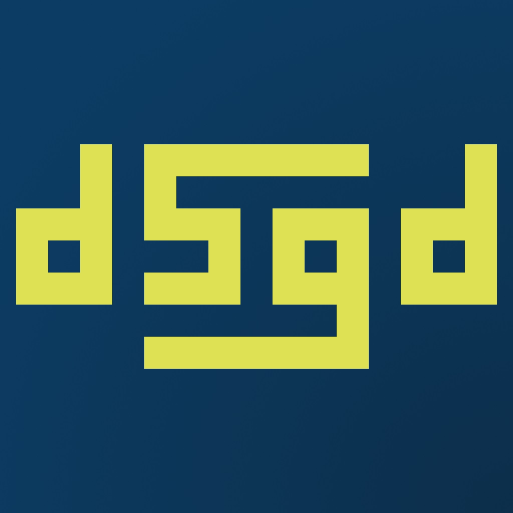

<div align="center">
  

## dsgd
### Unofficial DirectStorage Binding for Godot 4

#### Up to:<br/>2.2x faster cold boots · 4.1x faster texture streaming · 1.8x smaller exported texture footprint<sup><a href="#note-1">*</a></sup><br/>in Windows 10/11<sup><a href="#note-2">**</a></sup>
</div>
<br/>

To quote from [Microsoft's readme](https://github.com/microsoft/DirectStorage) about DirectStorage,

> DirectStorage is a feature intended to allow games to make full use of high-speed storage (such as NVMe SSDs) that can can deliver multiple gigabytes a second of small (eg 64kb) data reads with minimal CPU overhead.

`dsgd` brings DirectStorage direct-to-VRAM texture streaming to Godot 4 on Windows (D3D12), using GDeflate compression by default for a smaller disk and export footprint, with a transparent multi-threaded CPU fallback on Linux, macOS, and non-D3D12 Windows renderers.

## Features

- **Hardware-Accelerated Texture Streaming**: Streams D3D12-aligned `.dstex` textures directly into VRAM on Windows D3D12 with minimal CPU overhead.
- **GDeflate Texture Compression**: Uses Godot's import pipeline to encode `.png`, `.jpg`, `.jpeg`, `.webp`, `.tga`, and `.dds` textures into GDeflate-compressed `.dstex` payloads (instead of `.ctex`, leaving source files untouched) for a smaller footprint and fast decompression.
- **Automatic Export Packaging**: Packs `.dstex` assets into a single `textures.dspkg` archive for low-overhead DirectStorage offset streaming (with optional basic TOC encryption), and deploys DirectStorage DLLs and license notices beside exported binaries.
- **Cross-Platform Software Fallback**: Runs the exact same `.dstex` and `.dspkg` assets on Linux, macOS, and non-D3D12 Windows via `SoftwareFallback` (multi-threaded CPU GDeflate decompression).
- **Drop-in `ResourceLoader` Integration**: Hooks Godot's `load()` transparently via `DSResourceFormatLoader` so existing scenes and scripts load `.dstex` and `.dspkg` assets with no code changes.
- **Async Texture Prewarming**: Provides `DSTextureCache` and `DSPreloader` for tagged, stutter-free background texture streaming and VRAM budget management.
- **Texture Migration Tool**: Includes an editor dialog (**Project > Tools > dsgd Tools... (DirectStorage) > Migrate textures to DirectStorage...**) to batch-convert existing project textures to `.dstex`.


## Supported Platforms

| Platform | Target Architectures | Backend | Notes |
| :--- | :--- | :--- | :--- |
| Windows 10/11 | `x86_64` | DirectStorage + GPU GDeflate (D3D12) | BypassIO on NVMe + NTFS; standard I/O on other local volumes. Falls back to `SoftwareFallback` on non-D3D12 renderers. |
| Linux | `x86_64` | `SoftwareFallback` (CPU GDeflate) | Repacks `.dspkg` uncompressed by default to preserve performance. |
| macOS | Universal (`x86_64`, `arm64`) | `SoftwareFallback` (CPU GDeflate) | Repacks `.dspkg` uncompressed by default to preserve performance. |

Requires **Godot 4.7** (tested on Godot 4.7.2).

## Installation & Quick Start

1. **Switch to D3D12 (Windows)**: If your project is not already using Direct3D 12, set **Project Settings > General > Rendering > Rendering Device > Driver.windows** (`rendering/rendering_device/driver.windows`) to `d3d12` and restart the editor.
2. **Install the Addon**: Place `directstorage_accelerator/` in your project's `addons/` directory and enable **dsgd - Unofficial DirectStorage binding** in **Project Settings > Plugins** (this registers the `DSRuntime` autoload).
3. **Install DirectStorage Runtime (Windows)**: Open **Project > Tools > dsgd Tools... (DirectStorage) > Manage DirectStorage Runtime...** to download, review Microsoft's license, and install `dstorage.dll` and `dstoragecore.dll` (the dialog opens automatically on Windows when you enable the plugin if the runtime DLLs are not installed yet). The runtime DLLs are not bundled in this repository and must be installed before exporting on Windows.
4. **Import & Export**: Newly imported textures use the `.dstex` importer (`3D (Streaming)` preset by default) and load transparently through `ResourceLoader.load()`. On export, the `dsgd` export plugin (`dsgd Extension`) packs them into `textures.dspkg` automatically.

## Documentation

- [Migration Guide](docs/migration-guide.md) - Batch-converting existing project textures to `.dstex` and rolling back
- [Texture Import & Compression](docs/import-and-compression.md) - `.dstex` workflow, NPOT sizing, GDeflate level guidance, and chunked payloads
- [Runtime Streaming, Prewarm & Caching](docs/runtime-streaming-and-prewarm.md) - GPU/CPU fallback, volume I/O, `DSPreloader` streaming, `DSTextureCache` ownership, stall diagnostics, and Runtime API
- [Diagnostics, Profiling & Benchmarking](docs/diagnostics-and-profiling.md) - `DSProfiler`, `DSContext` capability/loader diagnostics, `DSRuntime` slice telemetry, and mode-switching
- [Benchmarks & Performance Analysis](docs/benchmarks.md) - Full cold-boot, background-streaming, and footprint breakdown for `arena_v2` and `bistro`
- [Addon Reference](project/addons/directstorage_accelerator/README.md) - `.dstex` import settings, `dsgd_extension/*` Project Settings, and export preset options
- [Exporting Your Project](docs/exporting-guide.md) - Standard export walkthrough, shipped files across Windows/Linux/macOS, and common export options
- [Encryption Guide](docs/encryption-guide.md) - `.dspkg` archive encryption and PCK key delivery
- [Verifying an Exported Build](docs/verifying-an-exported-build.md) - Checking exported archives, runtime DLLs, and license outputs
- [Custom Godot Builds](docs/custom-godot-builds.md) - Building Godot from source with D3D12 enabled
- [Demo Project (`project/README.md`)](project/README.md) - F5 A/B benchmark and 5-mode loading demo (`loading_demo_menu.tscn`, procedural asset generator setup via EditorScript or headless CLI)

### For Developers
- [Building & Testing from Source](docs/for_developers/building-and-testing.md) - Prerequisites, DirectStorage SDK fetch, `gdextest` suites, `.env` remote builds, artifact sync, and GDExtension hot-reload
- [Worktrunk Setup](docs/for_developers/worktrunk-setup.md) - Parallel agent worktree workflow, shared SCons cache, and prebuilt `godot-cpp` setup
- [Binary Format Version History](docs/for_developers/format-versions.md) - `.dstex` (v1–v3) and `.dspkg` (v1–v5) layouts, defaults, and capability bits
- [GDeflate Compression Level Benchmarks](docs/for_developers/gdeflate-compression-benchmarks.md) - Per-asset S3TC, stylized, and RGBA8 compression tables and timings
- [Export & Archive Behaviour](docs/for_developers/export-and-archive-behaviour.md) - Developer internals for export packaging and archive layout

## Building from Source

**Prerequisites**: Git, Python 3.8+, SCons `>= 4.11`, and (on Windows) Visual Studio 2022/2026 Build Tools with the C++ workload and Windows 10/11 SDK.

```powershell
git submodule update --init --recursive
python -m pip install --upgrade "scons>=4.11"
powershell -NoProfile -ExecutionPolicy Bypass -File tools/fetch_directstorage.ps1

scons platform=windows target=template_debug
scons platform=windows target=template_release
```

On Linux or macOS, pass `platform=linux` or `platform=macos` (no DirectStorage SDK fetch needed; builds `SoftwareFallback`). Compiled binaries are placed in `project/addons/directstorage_accelerator/bin/`.

## Roadmap
- [ ] Windows on ARM support
- [ ] Support Embed PCK binary format
- [ ] Zstd asset compression export for MacOS/Linux for faster CPU decompression
- [ ] Full on GPU Zstd decompression support (DirectStorage 1.4)

## Contributing

Contributions are welcome! Please read [CONTRIBUTING.md](CONTRIBUTING.md) for SPDX header conventions, build/test checks, and our [Contributor License Agreement (CLA.md)](CLA.md).

## Trademarks and Attribution

### License

`dsgd` is licensed under the **Mozilla Public License, v. 2.0 (MPL-2.0)** (`LICENSE`), except for the four shipped runtime GDScript helpers (`ds_runtime.gd`, `ds_preloader.gd`, `ds_batch_manager.gd`, and `ds_dspkg_static.gd`), which are licensed under the **MIT License** (`LICENSE-MIT`) so games can freely localize, tune, or adapt them.

- **Closed-source and commercial games are permitted:** You can bundle `dsgd` with proprietary games without disclosing your game's own code or assets; only modifications made to `dsgd`'s own MPL-2.0 files must be shared under MPL-2.0.
- **Export compliance (MPL-2.0 Section 3.2(a)):** Keep `dsgd_extension/include_dsgd_license_file` enabled (default) so `dsgd_LICENSE.txt` is written beside exported binaries. If you disable it to display attributions in-game, include the MPL-2.0 license notice, the DSGD source URL (`https://github.com/medium-effort/godot-directstorage-extension`), and the attributions from `THIRD_PARTY_NOTICES.txt` (plus Microsoft's DirectStorage runtime `LICENSE.txt` and `NOTICES.txt` when shipping `dstorage.dll` / `dstoragecore.dll`).

### Trademarks and Notices

This project (dsgd) is an independent project and is not affiliated with, endorsed by, or sponsored by Microsoft. Microsoft and DirectStorage are trademarks of the Microsoft group of companies. The DirectStorage SDK and runtime are used under Microsoft's license and are not redistributed from this repository; see [Building from Source](#building-from-source).

Third-party license texts and attributions are in `THIRD_PARTY_NOTICES.txt` at the repository root; the project's own licenses are in `LICENSE` (MPL-2.0) and `LICENSE-MIT` (MIT). The build copies them into the addon folder, and the exporter deploys them next to exported binaries as `dsgd_LICENSE.txt` (with the DirectStorage runtime texts appended when merging is enabled) or as a separate `DIRECTSTORAGE_LICENSE.txt`. These files are exporter-managed: every export removes them and writes the set selected by the preset, so disabling an option deletes the previous export's copy.

---

<details>
<summary><b>AI Disclaimer</b></summary>

Most of the source code of this project are written with the assistance of AI.

List of tools used:
- Antigravity IDE
- Opencode
    - opencode-rules

List of models used:
- Gemini 3.6 Flash
- Gemini 3.7 Flash
- Gemini 3.8 Flash
- Gemini 4 Argon
- Gemini 4 Hydrogen
- Gemini 4 Neon
- Claude Opus 4.6
- Claude Sonnet 4.6
- Claude Opus 5.5
- Claude Sonnet 5.5
- Muse Spark 1.2 Contributor
- Muse Spark 1.3 Contributor
- Hy4 Flash
- Deepseek V4.1 Flash 1017
- Beam Free
- Kimi K3
- GPT 5 Luna

</details>


---

<a id="note-1"></a>
\* Based on median 5-iteration benchmarks (arena_v2 and bistro presets, exported release, 1080p) on an Intel Core i3-12100F, GTX 1050 Ti (D3D12, GPU GDeflate), and NVMe SSD with cold OS file cache (FILE_FLAG_NO_BUFFERING) on Windows 11. Texture footprint compares .dspkg (GDeflate) against uncompressed S3TC .ctex payloads. See [Benchmarks & Performance Analysis](docs/benchmarks.md) for full tables and methodology.

<a id="note-2"></a>
\*\* Full DirectStorage DMA and GPU GDeflate decompression require Windows 10/11 (x64) with Godot's D3D12 renderer. The same sources and `.dspkg`/`.dstex` assets also run cross-platform on desktop (Linux, macOS, and non-D3D12 Windows) via the `SoftwareFallback` backend (multi-threaded CPU GDeflate decompression); Linux and macOS exports repack `.dspkg` uncompressed by default (`dsgd_extension/store_uncompressed_textures`) to preserve performance, and can disable that option to keep the smaller GDeflate footprint.